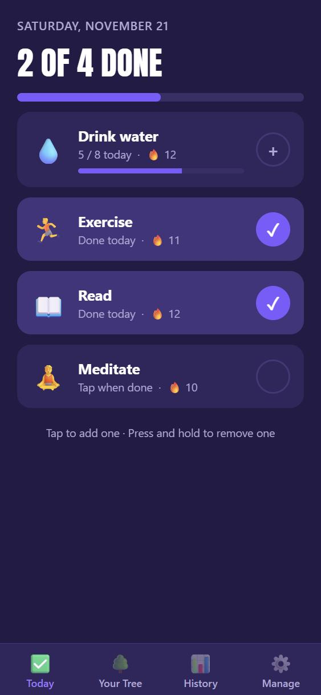
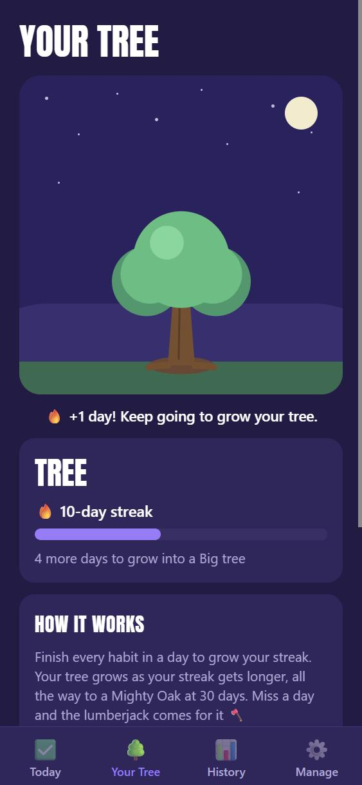
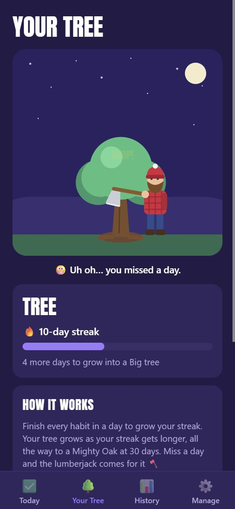
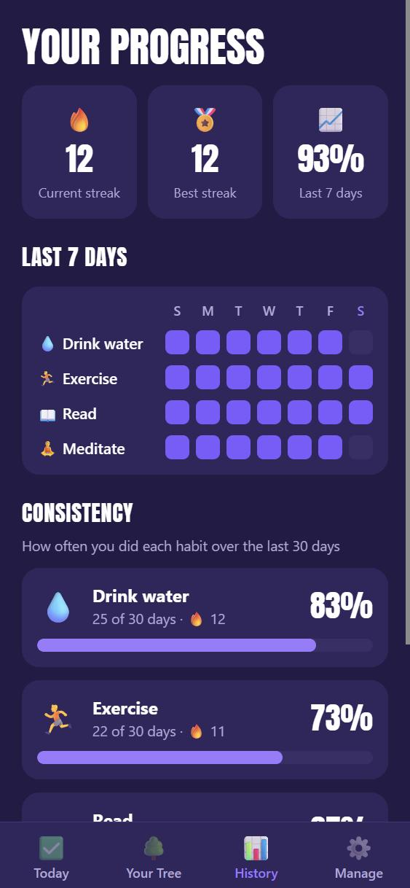

# 🌳 Habit Tracker

A mobile habit tracker where **your streak grows a tree**. Finish every habit in a day and your tree grows a little bigger. Miss a day and a lumberjack shows up to chop it down. 🪓

**[▶ Try the live demo](https://jack1071-habit-tracker.expo.app)** (works best at phone size)

<p>
  
  
  
  
</p>

## Features

- **Tap to log habits.** Once-a-day habits check off with one tap. Counted habits (like 8 glasses of water) fill up one tap at a time. Press and hold to remove one.
- **Rewards on every tap.** Haptic buzz, a bounce animation, and emoji confetti when you finish the day.
- **Your Tree.** A tree that grows through 8 stages as your streak gets longer, from a seed to a Mighty Oak at 30 days. Break the streak and a lumberjack walks in, chops it down, and you start again from a seed.
- **3-day kickstart challenge** for new users, with a trophy at the end.
- **History.** Current and best streaks, a 7-day grid, and 30-day consistency bars for each habit.
- **Manage habits.** Add your own with a custom icon and daily target, or delete them.
- **Saves on the device**, so your habits are still there when you reopen the app.

## How it's designed

I planned the app with a 5-step framework before building it:

| Step | In this app |
|---|---|
| **Core function** | Track a habit |
| **Core loop** (action → reward in under 30 seconds) | Tap a habit → buzz, bounce, confetti |
| **Accessory features** (only what supports the loop) | History, streaks, consistency bars, counted habits |
| **Surface area** (5–7 screens max) | 5 screens: Welcome, Today, Your Tree, History, Manage |
| **Retention hook** | 3-day kickstart challenge, and a tree you don't want to lose |

## Built with

- [React Native](https://reactnative.dev) + [Expo](https://expo.dev) (SDK 58) and Expo Router
- TypeScript
- `react-native-svg` for the tree and lumberjack drawings
- React Native `Animated` for the grow, chop and confetti animations
- `expo-haptics` for vibration feedback
- AsyncStorage for saving data on the device
- Published with EAS Update (phone) and EAS Hosting (web)

Built with [Claude Code](https://claude.com/claude-code) as an AI pair programmer while following a course on building mobile apps.

## Run it yourself

1. Install dependencies:
   ```bash
   npm install
   ```
2. Start the app:
   ```bash
   npx expo start
   ```
3. Scan the QR code with the **Expo Go** app on your phone, or press `w` to open it in your browser.

If your phone can't connect over Wi-Fi, use `npx expo start --tunnel` instead.

## Project structure

```
src/
  app/
    _layout.tsx         Loads the font and sets up the app
    index.tsx           Main screen: app state, tabs, celebrations
  components/
    screens/            Onboarding, Today, Your Tree, History, Manage
    tree-art.tsx        SVG drawings of the tree stages, stump and lumberjack
    celebration.tsx     Confetti animation
  lib/
    habits.ts           Data types, saving, streak and consistency maths
    ui.ts               Colors, fonts and haptics
```

## License

MIT
